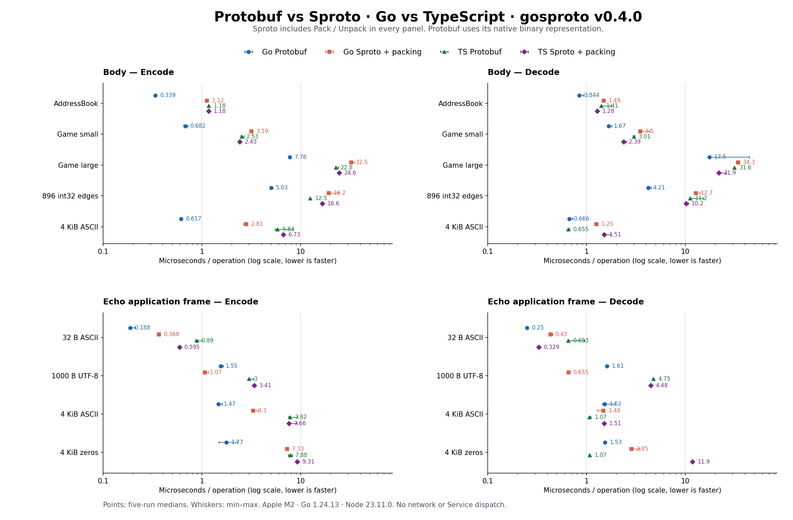

# Protobuf / Sproto × Go / TypeScript 完整复测（v0.4.0）

本轮直接使用已发布 gosproto v0.4.0，无 replace、无临时 modfile。两套已有基准全部重跑：每种语言 72 项，各五轮，共 144 个实现/操作组合、720 个计时样本。所有语义、固定字节签名和 padding 检查通过，boolean/混合正负安全 int64 两个额外探针通过。

两套基准及各语言顺序执行，没有并行跑其他测试、性能采样或 profile；本轮未修改编解码器，也未重采 CPU/分配 profile。

## 本轮主要结论

1. **Go 游戏数值消息仍以 PB 更快。** 大型游戏消息编码 PB 7.756 µs，SP 原始编码 26.973 µs，含 Pack 为 32.453 µs；解码 PB 17.505 µs，SP 含 Unpack 为 34.298 µs。Go SP 的临时分配已明显减少，但这不等于反射与边界检查等 CPU 成本消失。
2. **TS SP 纯编解码已经有竞争力。** 大型游戏消息 SP Encode 17.853 µs、Decode 16.644 µs，PB 分别为 22.781 / 31.551 µs。加入 packing 后 SP 为 24.619 / 21.948 µs：编码约慢 8%，解码约快 30%。本机小差异仍需结合波动看，不能只看纯 Encode 给完整路径排名。
3. **小包在客户端与服务端表现不同。** 32 B Echo 完整帧，Go PB 编解码为 0.188 / 0.250 µs，Go SP 为 0.368 / 0.430 µs；TS PB 为 0.890 / 0.653 µs，TS SP 为 0.595 / 0.329 µs。这里的 Go/TS 差异包含库实现、生成代码/反射及资源检查差异，不能归因于语言本身。
4. **普通数据中 SP packed 并不总比 PB 小。** AddressBook 为 83 对 69 B，大型游戏消息为 2280 对 2081 B；896 元素边界数组 SP 为 2374 B，比 PB 2435 B 小约 2.5%。两种协议原生编码选择不同，PB 数组已显式 packed，负数使用 sint32。
5. **高压缩率样本暴露 TS 解包成本。** 全零 4 KiB Echo 的 SP 帧为 519 B，PB 为 4107 B，节省约 87.4%；但 TS SP 帧解码为 11.854 µs，PB 为 1.074 µs，约 11 倍耗时。它与旧基线约 12.118 µs 接近，是仍需关注的场景；本轮未做新的 profile，因此不把具体函数归因为已确认根因。
6. **优化收益在正式发布版复测中保持。** 对比 [Echo 基线](../2026-10-15/report.md) 与 [代表性基线](../2026-10-15-representative/report.md)，TS 4 KiB ASCII 帧编码约 19.292 → 7.660 µs；大型游戏消息 TS Encode 34.600 → 17.853 µs。当前结果与上一轮相同源码的本地优化测量接近，没有观察到发布依赖导致的新回退。



图中横轴为对数尺度，点为五轮中位数，线为最小到最大值，越靠左越快。上排 body 的 SP 包含 packing、PB 使用原生编码；下排为完整 Echo 应用帧。原始 body 不 packing 的结果另列于下一节。

## 如何读表

耗时单位均为 µs/op，取五轮中位数，越低越好。先看纯 body 的 Encode/Decode，再看实际需要 packing 的路径；不要将 SP Encode 的数字直接用作 Encode+Pack。大小表是 wire 字节，Go B/op 是内存分配，两者含义不同。

- 代表性消息没有 Envelope/package：PB Encode/Decode；SP Encode/Decode；SP Pack/Unpack；SP PEncode=Encode+Pack，PDecode=Unpack+Decode。
- Echo 同时测 payload 和应用帧。PB frame 包含 Envelope；SP frame 包含原生 package(type/session) 和 packing。
- Go 固定 GOMAXPROCS=1、200 ms/样本；TS 单线程，保留 JIT/GC，独立热身后约 100 ms/样本，并在轮间反转操作顺序。
- Go Sproto 保留反射、资源预算与失败原子性；Go PB 使用生成代码，TS PB 使用 @bufbuild/protobuf，TS SP 使用修正后的 sealindx/sproto-ts Node Buffer 实现。这里比较当前实现，不将结果扩大为协议或语言的固有性能。
- 字符串校验语义也不同：Echo 的 Go PB proto3 string 编解码包含 UTF-8 校验，Go SP string 按字节复制/转换，不强制校验 UTF-8。因此 UTF-8 场景的速度差包含库契约差异，本轮未重新 profile，不将某一项检查认定为全部差距的原因。

## 纯 body：四种实现直接对比

| 消息 | 操作 | Go PB | Go SP | TS PB | TS SP |
| --- | --- | ---: | ---: | ---: | ---: |
| AddressBook | encode | 0.339 | 0.871 | 1.176 | 0.754 |
| AddressBook | decode | 0.844 | 1.280 | 1.407 | 1.026 |
| 小型游戏状态 | encode | 0.682 | 2.616 | 2.534 | 1.698 |
| 小型游戏状态 | decode | 1.672 | 2.983 | 3.014 | 1.815 |
| 大型游戏状态 | encode | 7.756 | 26.973 | 22.781 | 17.853 |
| 大型游戏状态 | decode | 17.505 | 29.063 | 31.551 | 16.644 |
| 896 个 int32 边界值 | encode | 5.030 | 13.125 | 12.514 | 9.786 |
| 896 个 int32 边界值 | decode | 4.208 | 7.334 | 11.207 | 4.617 |
| 4 KiB ASCII body | encode | 0.617 | 0.647 | 5.828 | 1.229 |
| 4 KiB ASCII body | decode | 0.666 | 0.761 | 0.655 | 0.487 |

## body 加 Sproto packing：四种实现直接对比

PB 使用原生 Encode/Decode，SP 使用 PEncode/PDecode；两侧均无应用帧头，不给 PB 额外添加通用压缩。

| 消息 | 操作 | Go PB | Go SP+packing | TS PB | TS SP+packing |
| --- | --- | ---: | ---: | ---: | ---: |
| AddressBook | encode | 0.339 | 1.124 | 1.176 | 1.176 |
| AddressBook | decode | 0.844 | 1.485 | 1.407 | 1.285 |
| 小型游戏状态 | encode | 0.682 | 3.186 | 2.534 | 2.426 |
| 小型游戏状态 | decode | 1.672 | 3.503 | 3.014 | 2.388 |
| 大型游戏状态 | encode | 7.756 | 32.453 | 22.781 | 24.619 |
| 大型游戏状态 | decode | 17.505 | 34.298 | 31.551 | 21.948 |
| 896 个 int32 边界值 | encode | 5.030 | 19.226 | 12.514 | 16.605 |
| 896 个 int32 边界值 | decode | 4.208 | 12.726 | 11.207 | 10.227 |
| 4 KiB ASCII body | encode | 0.617 | 2.815 | 5.828 | 6.730 |
| 4 KiB ASCII body | decode | 0.666 | 1.252 | 0.655 | 1.509 |

## Echo payload 与完整应用帧

| 层级 | 内容 | 操作 | Go PB | Go SP | TS PB | TS SP |
| --- | --- | --- | ---: | ---: | ---: | ---: |
| payload | 32 B ASCII | encode | 0.067 | 0.102 | 0.393 | 0.128 |
| payload | 32 B ASCII | decode | 0.109 | 0.177 | 0.317 | 0.108 |
| payload | 1000 B UTF-8 | encode | 1.286 | 0.235 | 1.869 | 1.549 |
| payload | 1000 B UTF-8 | decode | 1.355 | 0.284 | 4.387 | 4.091 |
| payload | 4 KiB ASCII | encode | 0.879 | 0.590 | 5.863 | 1.255 |
| payload | 4 KiB ASCII | decode | 0.988 | 0.665 | 0.740 | 0.505 |
| payload | 4 KiB 零字节 | encode | 0.872 | 0.582 | 5.617 | 1.250 |
| payload | 4 KiB 零字节 | decode | 0.998 | 0.641 | 0.745 | 0.511 |
| frame | 32 B ASCII | encode | 0.188 | 0.368 | 0.890 | 0.595 |
| frame | 32 B ASCII | decode | 0.250 | 0.430 | 0.653 | 0.329 |
| frame | 1000 B UTF-8 | encode | 1.549 | 1.073 | 3.003 | 3.410 |
| frame | 1000 B UTF-8 | decode | 1.608 | 0.655 | 4.747 | 4.483 |
| frame | 4 KiB ASCII | encode | 1.474 | 3.296 | 7.823 | 7.660 |
| frame | 4 KiB ASCII | decode | 1.522 | 1.479 | 1.073 | 1.507 |
| frame | 4 KiB 零字节 | encode | 1.770 | 7.333 | 7.879 | 9.306 |
| frame | 4 KiB 零字节 | decode | 1.534 | 2.849 | 1.074 | 11.854 |

## 单独 Pack / Unpack

这些操作只用于 SP body，不与 PB Encode/Decode 当作同一操作。

| 消息 | Go Pack | Go Unpack | TS Pack | TS Unpack |
| --- | ---: | ---: | ---: | ---: |
| AddressBook | 0.263 | 0.177 | 0.423 | 0.262 |
| 小型游戏状态 | 0.566 | 0.487 | 0.742 | 0.559 |
| 大型游戏状态 | 5.476 | 5.092 | 6.601 | 5.320 |
| 896 个 int32 边界值 | 6.060 | 5.353 | 6.983 | 5.687 |
| 4 KiB ASCII body | 2.118 | 0.535 | 5.572 | 0.948 |

## Wire 大小

同一 fixture 在 Go/TS 的签名一致，因此每个协议只列一次大小；单位为字节。

| body | PB | SP raw | SP packed | packed / PB |
| --- | ---: | ---: | ---: | ---: |
| AddressBook | 69 | 130 | 83 | 1.203 |
| 小型游戏状态 | 191 | 328 | 216 | 1.131 |
| 大型游戏状态 | 2081 | 3336 | 2280 | 1.096 |
| 896 个 int32 边界值 | 2435 | 3593 | 2374 | 0.975 |
| 4 KiB ASCII body | 4099 | 4104 | 4103 | 1.001 |

| Echo 内容 | PB payload | SP payload | PB frame | SP packed frame |
| --- | ---: | ---: | ---: | ---: |
| 32 B ASCII | 34 | 40 | 41 | 43 |
| 1000 B UTF-8 | 1003 | 1008 | 1011 | 1012 |
| 4 KiB ASCII | 4099 | 4104 | 4107 | 4109 |
| 4 KiB 零字节 | 4099 | 4104 | 4107 | 519 |

## Go 分配

每格为 B/op / allocs/op；TS 本轮不测精确堆分配，不把旧 V8 采样估计当作 B/op。Echo 完整分配另见 [Echo 明细](echo/report.md)。

| body | PB Enc | SP Enc | PB Dec | SP Dec | SP PEnc | SP PDec |
| --- | ---: | ---: | ---: | ---: | ---: | ---: |
| AddressBook | 80 / 1 | 144 / 1 | 648 / 26 | 528 / 29 | 288 / 2 | 672 / 30 |
| 小型游戏状态 | 192 / 1 | 352 / 1 | 1208 / 53 | 1248 / 54 | 704 / 2 | 1600 / 55 |
| 大型游戏状态 | 2304 / 1 | 3456 / 1 | 13560 / 537 | 10464 / 534 | 6912 / 2 | 13920 / 535 |
| 896 个 int32 边界值 | 2688 / 1 | 4096 / 1 | 4160 / 2 | 8312 / 5 | 8192 / 2 | 12408 / 6 |
| 4 KiB ASCII body | 4864 / 1 | 4864 / 1 | 4160 / 3 | 4176 / 5 | 9728 / 2 | 9040 / 6 |

## 采样波动

以下项目 max/min 超过 2；全部样本照录，未删掉最慢轮次，中位数也不构成显著性检验。其余项目的每轮值见原始文件。

| 套件 | 实现 | 项目 | min µs | median µs | max µs | max/min |
| --- | --- | --- | ---: | ---: | ---: | ---: |
| 代表性 | Go | game_large/protobuf_decode | 17.385 | 17.505 | 44.390 | 2.55 |
| 代表性 | TS | echo_ascii4k/sproto_decode | 0.485 | 0.487 | 1.307 | 2.70 |

## 环境、来源与覆盖边界

Apple M2；darwin 23.4.0 arm64；go version go1.24.13 darwin/arm64；Node v23.11.0。Go PB v1.36.1、Go SP v0.4.0、TS PB 2.15.0；TS SP 为示例内修正版本。

代表性套件开始于 2026-10-15T05:29:42.097Z，Echo 开始于 2026-10-15T05:31:49.833Z。代表性采样启动时的 GSR 提交为 77bbbaa，包含已升级依赖的工作树；该升级随后提交为 f82551c，Echo 使用 f82551c。两次采样的编解码源码哈希一致，两个 GSR 提交之间没有修改 Benchmark/编解码源代码。原始环境文件保留这个过程。

代表性采样 load average：开始 [4.35498046875, 5.2900390625, 5.18017578125]，结束 [6.5361328125, 5.64013671875, 5.31396484375]；这是仍有桌面负载的开发机，不能把小幅波动当作稳定收益。

覆盖官方 AddressBook、两档含结构体/字符串/数值数组的游戏状态、int32 边界数组、短/长 ASCII、UTF-8 和零字节文本。boolean 与混合正负安全 int64 本轮只做正确性探针，没有纳入性能表；未测 binary 专项、double、map、BigInt、完整 int64、浏览器、Lua/C、并发吞吐或网络/Service 端到端时延。

零字节样本刻意高压缩，不能代表普通游戏数据。Echo frame 的 TS SP 固定请求头长 6 字节，不含通用路由/会话表、安全预检或 MAC。body 与 frame 分开分析，不跨层级平均，也不把不同场景平均成一个总冠军。

输入、源码与工具版本见 [输入指纹](inputs.json)。原始五轮：[代表性 Go](representative/go.txt)、[代表性 TS](representative/typescript.json)、[Echo Go](echo/go.txt)、[Echo TS](echo/typescript.json)。环境：[代表性](representative/environment.json)、[Echo](echo/environment.json)。

## 复现

```sh
npm --prefix examples/websocket-gate ci
npm --prefix examples/websocket-gate run bench:representative -- /absolute/output/representative
npm --prefix examples/websocket-gate run bench:protocol -- /absolute/output/echo
```

两条计时命令顺序执行。schema 构建、正确性断言与初次扩容在计时外；输入复用，编码输出分配和每次新对象解码计时。现有脚本会输出两套明细报告，本文件将同一批采样汇总为四种实现的横向对比。
